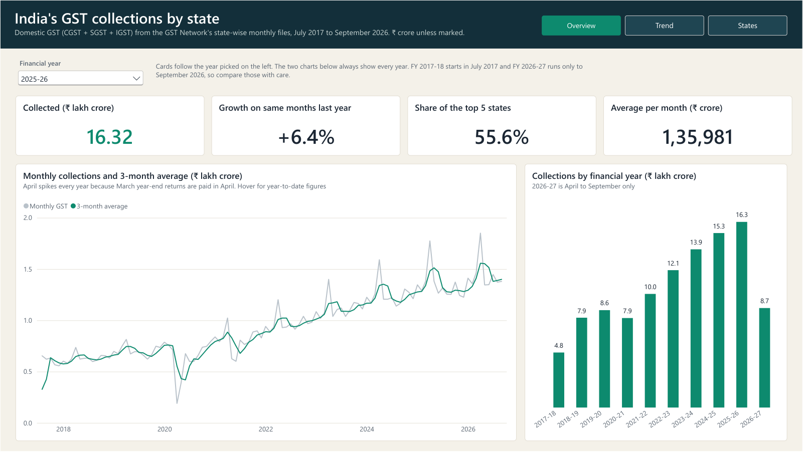
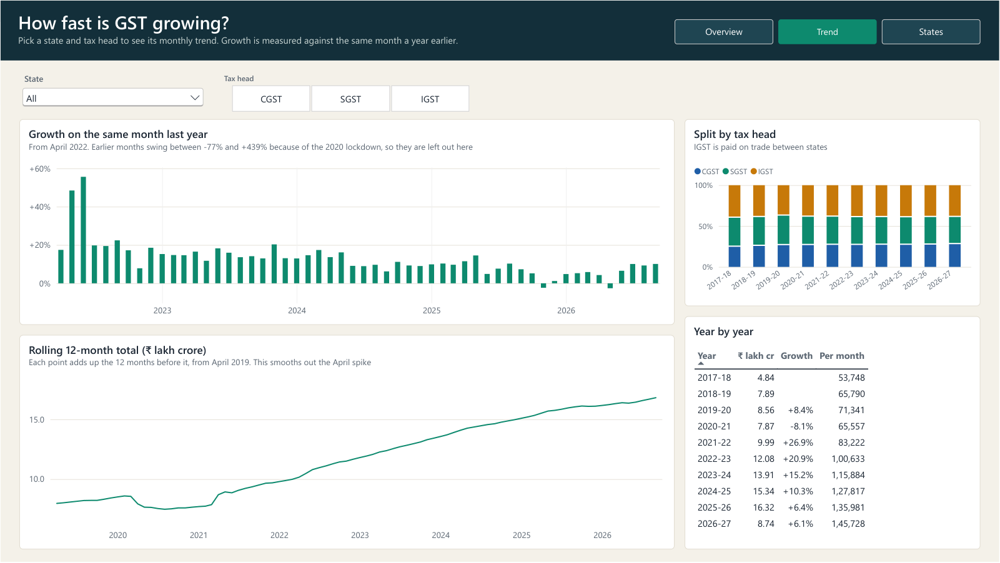
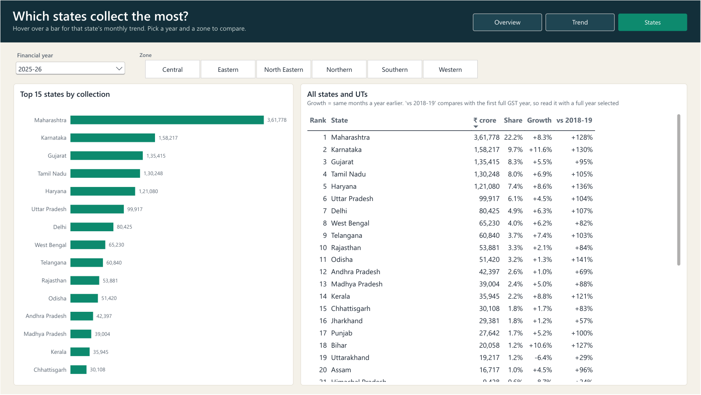

# India's GST collections by state

GST collections are reported every month as one big all-India number. I wanted to see which states that money actually comes from, whether the gap between the big states and the rest is changing, and how fast collections are still growing. So I built a Power BI dashboard from the GST portal's state-wise collection files, covering July 2017 (when GST started) to September 2026.

## Findings

All numbers are domestic GST (CGST + SGST + IGST) collected in each state, in ₹ crore. I used 2018-19 as the base year because it is the first full year of GST.

Collections roughly doubled, from ₹7.89 lakh crore in 2018-19 to ₹16.32 lakh crore in 2025-26 (+107%).

But growth has slowed every year since the post-lockdown rebound: 26.9% in 2021-22, then 20.9%, 15.2%, 10.3% and 6.4% in 2025-26. April to September 2026 was 6.1% higher than the same months of 2025.

November 2025 was 2.3% lower than November 2024. That was the first month below the year before since June 2021, and May 2026 dipped again (-2.6%). The November fall came soon after the GST rate cuts of 22 September 2025, but this data alone can't tell how much of the dip is because of them. July to September 2026 were back to about 9-10% growth.

The 2020 lockdown is easy to spot: April 2020 collections were ₹18,974 crore against ₹75,674 crore in February 2020, 77% below April 2019.

Collections are getting more concentrated, not less. The top 5 states had 52.2% of the total in 2018-19 and 55.6% in 2025-26. Maharashtra alone went from 20.1% to 22.2%. Karnataka moved past Gujarat into second place.

Among the 15 biggest states, growth from 2018-19 to 2025-26 ranged from +69% (Andhra Pradesh) to +141% (Odisha). Haryana (+136%), Karnataka (+130%) and Maharashtra (+128%) grew faster than India as a whole, while West Bengal (+82%) and Rajasthan (+84%) grew slower.

The split between tax heads hardly moved: in 2025-26 IGST was 39%, SGST 34% and CGST 27%, close to the 2018-19 split.

## Data

The source is the [GST statistics page](https://www.gst.gov.in/download/gststatistics) on the GST portal, which has one Excel file per financial year ("State-wise GST collection"), 10 files from 2017-18 to 2026-27. `fetch_data.py` downloads them into `data/`. The files are small, so they are in the repo.

The files look similar but are not the same:

- The layout is a pivot table with merged headers. Each month is a block of columns, and the month name sits only in the first column of the block, so it has to be filled across before the columns mean anything.
- The first block in every file is the year total, labelled "Financial Year 2017-18" in some files, "TOTAL" in 2019-20 and "Financial Year (up to the Month - Mar 2025)" in later ones.
- Month headers are real dates in most files, but April 2018 is the text `Apr-18`.
- Up to 2024-25 each month has 5 columns (CGST, SGST, IGST, CESS, TOTAL). From 2025-26 the CESS column is gone and each month has 4. I left cess out of everything so the years compare like for like.
- The sheet I need is the only sheet in the first three files and the second of three sheets after that, so it is picked by name (`Collections-Statewise`).
- State codes are numbers in some files and text with a leading zero (`01`) in others.
- Names change across files: `Andaman and Nicobar Island` vs `Islands`, the code 99 row is `CBIC` in early files and `OIDAR` later, and the header is `State Cd` or `State CD`.
- Daman and Diu (code 25) and Dadra and Nagar Haveli (code 26) are separate rows up to 2025-26, even after the two were merged in 2020. The 2026-27 file has only code 26. `data/states.csv` maps both codes to the merged UT. Ladakh (code 38) appears from 2019-20.
- Totals and footnote rows have to be dropped: `Grand Total` or `Domestic GST Collection- All India`, `Gross Revenue`, and `IGST and CESS on Import - All India` (just `IGST on Import - All India` in 2026-27). Two files also have a stray `s` typed in an empty column next to Jharkhand.
- July 2017 is almost zero for every state, because GST for July was paid in August.

`states.csv` is the only file I made by hand. It gives each state code a clean name, a zone (based loosely on the Zonal Councils) and whether it is a state or UT.

All the cleaning is in Power Query: `fnReadYear` reads one file and `gst` combines the folder. It ends with 12,849 rows (state x month x tax head). `check_numbers.py` reads the same files separately with pandas and works out every number in this README, saved in `facts.json`. I checked the dashboard measures against it, and also checked that CGST + SGST + IGST + CESS equals the TOTAL column in every state and month (it does).

## Model and measures

It's a star schema with one fact table and three dimensions:

- `gst`: month, state code, tax head, amount (₹ crore)
- `states`: state, zone, state or UT
- `tax_heads`: CGST, SGST, IGST
- `Calendar`: a daily DAX calendar with financial year (April to March) columns, marked as the date table

There are 14 measures. The main ones:

- `GST (Cr)`: the total, and `Share of India` for a state's share
- `YoY %`: against the same months a year earlier, using `SAMEPERIODLASTYEAR`. Because the calendar stops at September 2026, picking 2026-27 compares April-September with April-September. It returns blank when the year before has fewer months of data, so 2018-19 shows no growth figure (2017-18 only has July to March).
- `FYTD (Cr)` with `TOTALYTD` and a 31 March year end, `FYTD YoY %`, and `MoM %` with `DATEADD`. These three show in the tooltip of the monthly chart on the Overview page.
- `Rolling 12M (Lakh Cr)` and `3M Avg (Lakh Cr)` with `DATESINPERIOD`
- `State Rank` with `RANKX` over the selected states, and `Top 5 Share` with `TOPN`
- `Growth vs FY 2018-19`

## The dashboard

- Overview: cards for the selected year (collection, growth, top 5 share, average per month), the monthly trend with a 3-month average and the yearly totals.
- Trend: growth against the same month last year, the rolling 12-month total, the tax head split and a year-by-year table. A state and a tax head can be picked.
- States: the top 15 states and a table of all states with rank, share and growth, with year and zone slicers. Hovering over a bar shows a tooltip page with that state's monthly trend.

The page buttons at the top switch between pages.

## Files

- `gst_dashboard.pbip` with the `gst_dashboard.SemanticModel` and `gst_dashboard.Report` folders: the Power BI project. The model is stored as TMDL text files and the report pages as JSON.
- `queries.pq` and `measures.dax`: copies of the M queries and the DAX (calendar table and measures), so the logic can be read without opening Power BI.
- `gst_dashboard.pdf`: an export of the three report pages.
- `fetch_data.py` downloads the yearly files and `check_numbers.py` recounts every figure in pandas. They need `requests`, `openpyxl` and `pandas`.
- `data/`: the downloaded files plus my `states.csv` lookup.

The `DataFolder` parameter is set to `C:\gst\data`. Before refreshing, either copy the `data` folder there or point the parameter at your own copy (Transform data, then Edit parameters).

## Limits

These are collections by the state where tax was paid, before IGST is settled between the Centre and states, so they are not the same as each state's GST revenue. Import IGST is not split by state in these files, so it is not included.

The figures are provisional, as the files themselves say, and 2026-27 only runs to September. Leaving cess out means my totals are lower than the gross GST figures in the news.

The dip in late 2025 lines up with the rate cuts, but I haven't controlled for anything else, so I'd treat that as a timing match, not a cause.

Tools: Power BI Desktop, Power Query (M), DAX, Python (pandas) for checking
